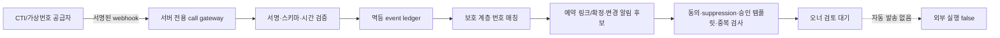

# CALL_ID_TECHNICAL_FEASIBILITY_POC v0.1

## 판정

부분 가능. 현재 저장소만으로 비식별 전화 이벤트 계약, 중복 제거, 예약 링크 후보 생성, 승인 템플릿·수신 동의·차단 상태를 확인하는 발송 전 판정까지 구현할 수 있다. 실제 전화 이벤트 수신은 CTI/가상번호 공급자 계약과 webhook 명세가 필요하며, 실제 알림톡 발송은 이번 POC에서 항상 비활성이다.

## 지금 바로 가능한 것

- `ringing | answered | ended | missed | failed | unknown` 상태를 opaque 이벤트로 수신하는 서버 계약
- `provider_event_id + call_state + shop reference` 기반 멱등 처리와 역순 이벤트 정렬
- 기존 예약 링크 생성 계약과 `booking_confirmed`, `booking_rescheduled_confirmed` 알림 유형 재사용 검토
- 기존 수신 거부, 승인 템플릿, 중복 발송 차단, 매장별 발송 원장 앞단에서 후보를 fail-closed로 판정
- UI에는 `call_event_id`, 상태, 시각, 연결 상태만 투영하고 공급자 ID와 전화번호는 제외

## 외부 공급자·계약이 필요한 것

- 수신·응답·종료·미응답 webhook을 제공하는 CTI 또는 가상번호 공급자
- 매장 번호 라우팅, 발신번호 표시, 장애 재전송, 서명 검증, event ordering에 대한 공급자 명세
- 전화번호를 보호 계층에서 고객·예약과 매칭하기 위한 개인정보 처리 근거와 보유·파기 정책
- 실제 알림톡은 기존 쏘다 승인 템플릿·발신 프로필·크레딧·relay 운영 조건 충족 필요

## Teepee 비교

- 확인된 내용: 이 저장소에는 CTI/가상번호 provider adapter와 call webhook endpoint가 없다.
- 미확인 내용: Teepee의 실제 통신 공급자, 번호 소유 구조, webhook 신뢰성, 자동 알림 조건, 요금과 개인정보 처리 방식은 제공된 저장소 증거가 없어 비교 확정할 수 없다.

## 최소 아키텍처

## 이벤트·알림톡 경계

- 전화번호 원문은 gateway의 보호 메모리/보호 저장소 밖으로 내보내지 않는다.
- 일반 원장과 UI에는 `anonymous_shop_ref`, opaque ID, 상태, 시각만 저장한다.
- `ended` 또는 `missed` 이후에만 후보 판정을 시작한다.
- 예약 확정·변경 안내는 예약 연결이 없으면 차단한다. 예약 링크도 수신 동의, suppression clear, 승인 템플릿을 모두 요구한다.
- 모든 조건을 통과해도 `eligible_for_owner_review`일 뿐이며 `automatic_send=false`, `external_execution=false`다.

## 위험

- 통신비밀·개인정보: 전화번호와 통화 메타데이터의 처리 목적, 최소 보유기간, 접근 권한, 파기 절차가 필요하다.
- 공급자 위조/재전송: webhook 서명, 허용 시간창, nonce/opaque event ID, rate limit이 필요하다.
- 잘못된 고객 매칭: 공동 번호·변경 번호·다견 고객 때문에 자동 예약 연결을 금지하고 오너 확인이 필요하다.
- 알림톡 오발송: consent/suppression/template/appointment snapshot/dedupe 중 하나라도 불명확하면 차단해야 한다.
- 장애 재시도: 무제한 재시도 금지, 지수 backoff와 dead-letter 검토가 필요하다.

## 대표 결정 1개

기술 검증용 CTI/가상번호 공급자 후보를 1곳 선정해 sandbox webhook 명세를 받아도 되는지 결정이 필요하다. 계약·구매·실전화 연결은 별도 승인 범위다.
